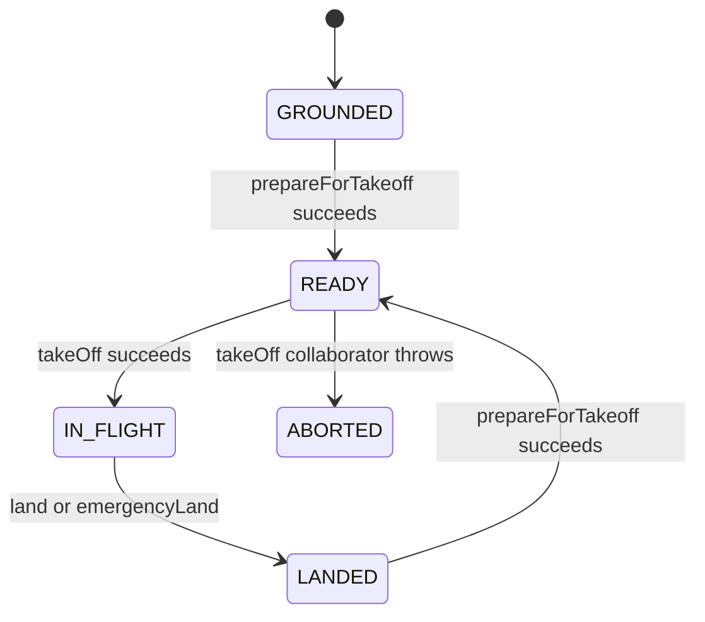

# CA2 Architecture and Test Design

## System boundary

`airplane.Aircraft` is the unit under test. It coordinates four collaborators supplied through its constructor:

| Collaborator | Responsibility used by `Aircraft` |
| --- | --- |
| `Engine` | Reports operational readiness, starts, and stops. |
| `FuelSystem` | Reports takeoff fuel availability and consumes fuel during cruise. |
| `LandingGear` | Retracts for takeoff and deploys for landing. |
| `NavigationSystem` | Reports whether a route is available. |

The constructor checks each collaborator for `null` with `Objects.requireNonNull`. Constructor injection is the test seam: tests instantiate a real `Aircraft` and provide fresh mocks for its dependencies. This isolates the coordinator's decisions without attempting to test the internal implementation of those component classes.

`FlightStatus` is the coordinator's observable state. `FlightException` represents disallowed lifecycle operations and selected operational failures. `IllegalArgumentException` represents a cruise amount rejected by the argument guard.

## Lifecycle and state changes

`prepareForTakeoff()` is allowed from `GROUNDED` or `LANDED`. It checks engine readiness, fuel sufficiency, and route availability in that order, stopping at the first false result. Only after all checks succeed does it set `READY`. A dependency exception during these checks is not caught by this method and therefore propagates unchanged.

`takeOff()` requires `READY`. It starts the engine, retracts the gear, and then sets `IN_FLIGHT`. A `RuntimeException` from either collaborator is caught, changes status to `ABORTED`, and is wrapped as the cause of a `FlightException`. Because the status update follows both collaborator calls, the `IN_FLIGHT` state is not set on this failure path.

`cruise(amount)` requires `IN_FLIGHT`, then rejects amounts for which `amount <= 0`. It next checks engine operation. A failed engine check invokes `emergencyLand()` and returns without consuming fuel. Otherwise it consumes the requested amount; a runtime failure there invokes emergency landing and is wrapped in `FlightException` with its cause preserved. The current numeric guard does not reject `NaN` or positive infinity: comparisons of either value with zero do not satisfy `<= 0`. The suite includes these as invalid inputs, so this is a known mismatch between the expected contract and current implementation, not a passing behavior.

`land()` and `emergencyLand()` both require `IN_FLIGHT` and call the shared landing sequence: deploy gear, stop engine, then set `LANDED`. Exceptions from those landing collaborator calls are not caught in the current implementation; status is only set after both calls finish.

All lifecycle guards use `ensureStatusIs`. If no allowed state matches, it throws `FlightException` and leaves the state unchanged.

## Test design

`AircraftTest` creates four fresh mocks and a new real `Aircraft` in `@BeforeEach`. This gives each test an isolated fixture. Setup helpers arrange a ready aircraft or an in-flight aircraft through public operations, keeping the tests aligned with observable behavior rather than directly editing internal status.

The test cases cover initial state, successful preparation, each readiness rejection, an exception from a readiness query, successful and failed takeoff, successful cruise and invalid amounts, engine failure during cruise, fuel-consumption failure, both landing operations, and a rejected takeoff from the initial state. Assertions combine state outcomes with collaborator interactions where those interactions define the expected coordination.

The assignment asks for at least six tests and lists Mockito APIs including `mock`, `reset`, `when`, `thenReturn`, `verify`, `times`, `any`, `thenThrow`, and `doNothing`. The suite has substantially more than six test methods and uses all the listed stubbing/verification APIs, with one type-specific adjustment: `FuelSystem.consumeFuel` takes a primitive `double`, so `anyDouble()` is the valid matcher for that argument. Mockito's generic `any()` returns a reference value and cannot be safely used in that primitive position because Java would unbox it. The component APIs expose no reference-argument method on which a meaningful generic `any()` invocation could be used. This preserves type safety while exercising the same wildcard-argument-matching purpose. If the course grader requires a literal call to `any()` rather than a type-appropriate matcher, that requirement cannot be met meaningfully with the current method signatures without adding an artificial production API.

`reset(fuelSystem)` in the successful-cruise test clears setup interactions after the helper has prepared and taken off the aircraft. It makes the subsequent `verify` specific to the call made by `cruise()`. Other tests retain setup interactions when they are relevant to the behavior under examination.

## Verification status and known limits

The suite has not been executed with Maven, so no passing result or test count from a test run is claimed. Run `mvn clean test` from the CA2 directory to verify it. In particular, the parameterized invalid-amount test is expected to expose the `NaN` and positive-infinity guard issue when executed against the current implementation. Production code has not been changed as part of this documentation.

The unit tests verify the `Aircraft` coordinator and its calls to doubles. They do not establish the correctness of the real `Engine`, `FuelSystem`, `LandingGear`, or `NavigationSystem` implementations; those would require their own focused tests if the assignment scope expands.
